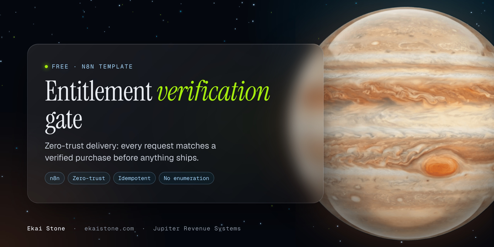
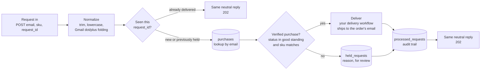

<p align="center"></p>

# Entitlement Verification Gate for n8n

**Zero-trust delivery for digital products: every request is matched to a verified purchase before anything ships, so your product only ever reaches the buyer's inbox.**

An importable n8n workflow that sits between "someone asked for the product" and "the product goes out." It normalizes the email, checks it against your verified purchase records, delivers only on a match, and quietly holds everything else for review. The caller always gets the same answer, so the endpoint can't be used to find out who bought what.

## The problem it solves

Most digital product delivery trusts the form. Whoever types an email into the intake or "resend my download" page gets the file. That breaks in predictable ways:

- **Typos.** `jane@gmial.com` gets a product nobody paid for, and the real buyer gets nothing.
- **Shared links.** A thank-you or intake URL gets forwarded, posted in a group, or indexed. Every visitor can claim the product.
- **Wrong inboxes.** A buyer checks out with one address and requests delivery to another, so the product leaves your control.
- **Chargebacks and refunds.** The order is reversed, but the automation keeps delivering because nothing checks the order's current status.
- **Double sends.** Double clicks, webhook retries and impatient refreshes each trigger another run.

The gate fixes all five with one rule: **no verified purchase in good standing, no delivery.** And when it does deliver, it ships to the email on the order, not the one typed into the form.

## How it works



| Step | Node | What it does |
|---|---|---|
| 1 | `Request in` | Webhook, `POST /webhook/entitlement-gate/request`. Accepts JSON or text/plain JSON (no CORS preflight from a browser form). |
| 2 | `Normalize request` | Trims and lowercases the email, validates it, optionally folds Gmail aliases (`jane.doe+promo@gmail.com` → `janedoe@gmail.com`, `googlemail.com` → `gmail.com`), cleans the sku, and sets a `request_id`. |
| 3 | `Seen this request?` / `Already delivered?` | Idempotency. A `request_id` that was already delivered returns the same reply and stops. |
| 4 | `Find purchases` | Looks up the `purchases` Data Table by normalized email. |
| 5 | `Verify entitlement` | Passes only if a row is `paid`, `active`, `completed` or `fulfilled` and matches the sku (when one was sent). Refunded, disputed, cancelled or pending orders fail. |
| 6a | `Deliver (connect your delivery workflow)` | A NoOp placeholder. Swap in an Execute Workflow node that calls your delivery. |
| 6b | `Hold for review` | Writes the request and an internal reason to `held_requests`. Nothing is sent to the caller. |
| 7 | `Log decision` | Writes every decision to `processed_requests`: your audit trail and dedupe key. |
| 8 | `Reply (neutral)` | Always `202 { ok: true, request_id, message }`, whatever happened. |

Each part has a sticky note inside the workflow.

## What's in the repo

```
workflows/
  entitlement-verification-gate.json   the gate
  record-purchase.json                 optional: writes purchases from your checkout's webhook
LICENSE
README.md
```

## Import (5 minutes)

1. **Create the three Data Tables** in n8n (Overview → Data tables → Create) with the columns below. Names must match exactly, or re-select the table on each Data Table node after import.
2. **Import the workflow.** In n8n: Workflows → Add workflow → ⋯ → Import from file → `workflows/entitlement-verification-gate.json`.
3. **Open each Data Table node** and confirm it points at the right table.
4. **Connect delivery.** Replace `Deliver (connect your delivery workflow)` with an Execute Workflow node that calls your delivery workflow, with "Wait for sub-workflow completion" turned off so verified and held requests reply in the same time. It receives `deliver_to`, `skus`, `order_id`, `request_id` and `email`.
5. **Fill `purchases`.** Import `workflows/record-purchase.json` and point your checkout's webhook at it, or write rows from your existing purchase workflow (see below).
6. **Publish**, then send a test request:

```bash
curl -X POST "https://YOUR-N8N-HOST/webhook/entitlement-gate/request" \
  -H "Content-Type: application/json" \
  -H "Idempotency-Key: test-001" \
  -d '{"email":"buyer@example.com","sku":"starter-kit"}'
```

With no matching purchase, you'll see the request in `held_requests` and the caller sees the neutral reply. Add a `paid` row for that email and sku, send it again with the same `Idempotency-Key`, and it goes through to Deliver.

## Data table schemas

All columns are `string` unless noted. n8n adds `id`, `createdAt` and `updatedAt` on its own.

**`purchases`** (your verified purchase records)

| Column | Example | Notes |
|---|---|---|
| `email` | `janedoe@gmail.com` | Store it **normalized the same way the gate does** (lowercase, and Gmail-folded if that option is on). |
| `sku` | `starter-kit` | Your product key. Lowercase, `a-z 0-9 _ -`. |
| `order_id` | `ord_10293` | From your checkout. |
| `status` | `paid` | `paid`, `active`, `completed`, `fulfilled` pass. `refunded`, `disputed`, `cancelled`, `pending` don't. |
| `purchased_at` | `2026-11-10T18:22:04Z` | ISO 8601. The newest matching order wins. |

**`held_requests`** (the review queue)

| Column | Notes |
|---|---|
| `request_id` | The idempotency key. |
| `email` | Normalized. |
| `email_as_typed` | Exactly what the form sent, so you can spot typos. |
| `sku` | Requested sku, may be empty. |
| `reason` | `no_purchase_for_email`, `purchase_not_in_good_standing`, `sku_not_purchased` or `invalid_email`. Internal only, never returned. |
| `status` | `held` on insert. Change it to `released` or `rejected` when you review it. |
| `user_agent` | First 300 characters. |
| `created_at` | ISO 8601. |

**`processed_requests`** (audit trail and dedupe)

| Column | Notes |
|---|---|
| `request_id` | Looked up on every request. |
| `email`, `sku` | Normalized. |
| `decision` | `deliver` or `held`. |
| `reason` | Same values as above, or `verified_purchase`. |
| `order_id` | The order that unlocked delivery. |
| `created_at` | ISO 8601. |

## Connect any checkout

The gate doesn't care which checkout you use. It only reads `purchases`. Get rows in there one of two ways:

**Option A: the included recorder.** Import `workflows/record-purchase.json`, set `WEBHOOK_TOKEN` in its Code node to a long random value, publish it, and point your checkout's webhook at `POST /webhook/entitlement-gate/purchase` with the header `x-webhook-token: <your value>`. It maps common payload shapes, normalizes the email the same way as the gate, and upserts one row per `order_id + sku`. Send refund and dispute events to the same URL so `status` flips and delivery stops.

| Checkout | How to point it here |
|---|---|
| Stripe | Use n8n's Stripe Trigger node (it verifies Stripe's signature) in front of the "Upsert purchase" step, or send `checkout.session.completed` and `charge.refunded` to the recorder through a signed relay. Put your product key in `metadata.sku`. |
| Shopify | Add an `orders/paid` and `refunds/create` webhook. Verify Shopify's HMAC header in the Code node, then map `line_items[].sku`. |
| GoHighLevel and other funnel builders | Add a webhook action on "order submitted" with a custom `x-webhook-token` header. Map the product to a sku. |
| Anything else | If your checkout's webhook can send JSON with an email, an order id, a status and a product key, the recorder can map it. Add your field paths to the `first(...)` lists. |

**Option B: your own purchase workflow.** If you already record purchases, add one Data Table "Upsert row" step that writes the five columns above. Normalize the email the same way.

## Security notes

- **No email enumeration.** Verified, held, duplicate and malformed requests all get the same `202` and the same body. The reason only goes to `held_requests`, never to the caller. Don't add a "we couldn't find your order" message to the reply; send that by email to the address on file if you need it.
- **Ship to the order, not the form.** Delivery goes to `deliver_to`, the email on the purchase row. A form can ask for a product, but it can't redirect it.
- **Status is checked every time.** A refund or chargeback that reaches `purchases` stops future deliveries immediately. There's no cached "this person is a buyer" flag.
- **Idempotency.** Pass an `Idempotency-Key` header (or `request_id` in the body). Without one, the gate derives a key from email + sku, so retries collapse into one request. Delivered ids never deliver again. Held ids are re-checked, so a request that arrived before its order is released on the next try.
- **Audit trail.** Every decision lands in `processed_requests` with the order that unlocked it. Every hold lands in `held_requests` with the raw email that was typed.
- **Race conditions.** Data Tables don't enforce unique keys. If two identical requests arrive in the same instant, both can pass the dedupe check. If that matters for your product, make your delivery workflow idempotent on `request_id` too, or move `processed_requests` to Postgres with a unique index on `request_id`.
- **Lock down CORS.** The webhook allows any origin so you can test quickly. Set "Allowed Origins" on `Request in` to your own domain before going live.
- **Recorder token.** `record-purchase.json` refuses every call until you change `WEBHOOK_TOKEN` from its placeholder. Use your checkout's own signature check wherever it offers one.

## Customize

- **Turn off Gmail folding:** set `FOLD_GMAIL_ALIASES = false` in `Normalize request` (and in the recorder).
- **Change what counts as paid:** edit `GOOD` in `Verify entitlement`.
- **Bundles:** write one `purchases` row per sku in the bundle, or expand bundle skus in `Verify entitlement`.
- **Notify on holds:** add an email or chat node after `Hold for review`, sent to you, not the requester.

## License

MIT. Use it, fork it, ship it in client builds.

---

Built by [Jupiter Revenue Systems](https://ekaistone.com). Star the repo if it helps.
